# Awesome-Unified-CRM-Customer-Engagement

  

# 🚀 Awesome Unified CRM & Customer Engagement

> 🌟 **A curated list of top Unified CRM and Customer Engagement platforms** — featuring both market-leading SaaS/Hosted enterprise suites and powerful self-hosted open-source alternatives for managing sales pipelines, marketing automation, omnichannel communications, and 360-degree customer relationships on a unified platform.
>
> ⭐ **Star this repository if you find it helpful!** ⭐

---

## 📋 Table of Contents

- [🌐 Sector Overview & Market Dynamics](#-sector-overview--market-dynamics)
- [🟦 SaaS / Hosted Platforms](#-saas--hosted-platforms)
  - [📊 SaaS Platforms Comparison & Financial Scale](#-saas-platforms-comparison--financial-scale)
  - [🏢 SaaS Product Deep Dives](#-saas-product-deep-dives)
- [🟩 Open-Source Software](#-open-source-software)
  - [⭐ Open-Source Software Ranked by GitHub_Stars](#-open-source-software-ranked-by-github-stars)
  - [💻 Open-Source Project Deep Dives](#-open-source-project-deep-dives)
- [📊 Feature Comparison Matrix](#-feature-comparison-matrix)
- [🔍 SEO & Keywords Guide](#-seo--keywords-guide)
- [🤝 Contributing](#-contributing)
- [💖 Support](#-support)
- [📈 Star History](#-star-history)
- [📄 License](#-license)

---

## 🌐 Sector Overview & Market Dynamics

The global CRM and customer engagement software market is estimated at **$88.4 billion in 2024 and is projected to surpass $160 billion by 2030** (growing at a compound annual growth rate of ~11–13%), propelled by generative AI copilot integrations, customer data platforms (CDP), and omni-channel messaging convergence.

The sector exhibits a **moderately fragmented yet top-heavy competitive structure**: enterprise giants (Salesforce, Microsoft, and HubSpot) anchor large institutional market share, but there is no singular winner-take-all monopoly because vertical-specific workflows, SMB pricing sensitivity, developer-first headless requirements, and stringent data sovereignty needs continue to fuel vibrant growth for specialized SaaS disruptors and autonomous open-source ecosystems.

---

## 🟦 SaaS / Hosted Platforms

Commercial, cloud-hosted Unified CRM and Customer Engagement platforms. These enterprise solutions offer managed cloud infrastructure, compliance certifications, and turnkey artificial intelligence capabilities.

### 📊 SaaS Platforms Comparison & Financial Scale

*Sorted in descending order by company scale (market valuation / enterprise capitalization / annual recurring revenue).*

| 🏢 Platform | 💰 Company Valuation / Revenue | 🏷️ Specific Starting Price | 🎁 Free Tier Limits / Free Trial Details | 🎯 Key Focus Area |
| :--- | :--- | :--- | :--- | :--- |
| **[Microsoft Dynamics 365](https://dynamics.microsoft.com/)** | **~$3.1 Trillion** market cap (Microsoft Corporation) | **$65 / user / month** (Dynamics 365 Sales Professional) | **30-day free trial** with full access to sales apps, sample datasets, and Copilot AI assistance | Enterprise ecosystem, Microsoft 365/Teams native workflows |
| **[Salesforce Customer 360](https://www.salesforce.com/)** | **~$280 Billion** market cap (NYSE: CRM, ~$38B ARR) | **$25 / user / month** (Starter Suite, billed annually) | **30-day free trial** including pre-built sales dashboards, lead management, and email integration | Global enterprise leader, Agentforce AI, custom app cloud |
| **[HubSpot CRM Suite](https://www.hubspot.com/)** | **~$33 Billion** market cap (NYSE: HUBS, ~$2.6B ARR) | **$15 / seat / month** (Starter Customer Platform, billed annually) | **Free forever plan** with up to 5 users, 1,000,000 contacts, contact & deal management, forms, and ticketing | Inbound marketing, polished UX, SMB-to-mid-market sales & service |
| **[Freshsales Suite](https://www.freshworks.com/crm/sales/)** | **~$4.5 Billion** market cap (NASDAQ: FRSH, ~$720M ARR) | **$9 / user / month** (Growth tier, billed annually) | **Free forever plan** for up to 3 users with contact management, built-in chat/phone, and account timelines | Mid-market unified sales, marketing, support, and Freddy AI |
| **[Zoho One](https://www.zoho.com/one/)** | **~$1.4 Billion+ ARR** (Bootstrapped, estimated valuation ~$15B) | **$37 / employee / month** (All-Employee pricing, billed annually) | **Free forever plan** (Zoho CRM standalone for up to 3 users) or **30-day free trial** of Zoho One suite | Flat-rate operating system with 45+ integrated business tools |
| **[GoHighLevel](https://www.gohighlevel.com/)** | **~$150 Million+ ARR** (Private equity valuation ~$2B–$3B) | **$97 / month** (Starter plan, billed monthly) | **14-day free trial** with full platform capabilities across 3 sub-accounts (SMS/email usage rebilled) | Agency white-label platform, funnels, multi-channel booking & CRM |
| **[ActiveCampaign](https://www.activecampaign.com/)** | **~$250 Million+ ARR** (Private, valued ~$3B+ in Series C) | **$15 / month** (Starter plan with 1 user, billed annually) | **14-day free trial** with full access to automation builder, campaigns, and up to 100 contacts | Deep behavioral marketing automation combined with lightweight CRM |
| **[Bitrix24](https://www.bitrix24.com/)** | **~$100 Million+ ARR** (Private, serving 15M+ registered orgs) | **$49 / month** total for 5 users (Basic plan, billed annually) | **Free forever plan** for unlimited users with 5 GB cloud storage, CRM pipelines, and CoPilot AI | Unified collaboration, internal chat, video tasks, and CRM pipeline |
| **[Keap](https://keap.com/)** | **~$100 Million+ ARR** (Private, backed by Bain Capital) | **$249 / month** for 3 users & 1,500 contacts (Pro tier, billed annually) | **14-day free trial** featuring sales pipelines, automated email marketing, and payment processing | All-in-one automation, lead intake, and CRM for small business owners |
| **[SugarCRM](https://www.sugarcrm.com/)** | **~$100 Million+ ARR** (Private, Accel-KKR portfolio) | **$19 / user / month** (Sugar Sell Essentials, 3 seat minimum, billed annually) | **7-day guided free trial** with access to omnichannel CRM workflows, reports, and dashboards | Enterprise customization, flexible on-prem or cloud data control |

---

### 🏢 SaaS Product Deep Dives

#### Salesforce Customer 360
* **Type:** Enterprise CRM with Agentforce AI 🤖
* **Overview:** Salesforce is the long-standing enterprise CRM market leader, connecting sales, customer service, marketing, and commerce into a single unified data architecture. Its metadata-driven data engine and Agentforce autonomous AI agents are industry benchmarks, though implementation complexity and per-tier expansion costs represent trade-offs for fast-growing businesses.
* **Pricing & Free Limits:** Starts at $25/user/month (Starter Suite). Offers a 30-day full-featured free trial with no credit card required.

#### HubSpot CRM Suite
* **Type:** Integrated inbound CRM, marketing, sales, and service suite 🎯
* **Overview:** HubSpot provides an intuitive, user-friendly platform with contact tracking, deal management, and Breeze AI copilots. Its modular Hubs scale seamlessly from bootstrapped founders to enterprise departments, though multi-hub professional tiers incur premium pricing.
* **Pricing & Free Limits:** Starts at $15/seat/month for the Starter Platform. Provides a free-for-ever plan supporting up to 5 users and up to 1,000,000 contacts.

#### Microsoft Dynamics 365
* **Type:** Enterprise CRM embedded in the Microsoft enterprise cloud 🏢
* **Overview:** Dynamics 365 Sales provides sales force automation, predictive forecasting, and customizable business intelligence dashboards natively integrated with Microsoft 365, Teams, and Copilot AI. Ideal for institutions already invested in the Microsoft stack.
* **Pricing & Free Limits:** Starts at $65/user/month for Sales Professional. Provides a 30-day comprehensive trial environment.

#### Zoho One
* **Type:** Comprehensive business operating system 💼
* **Overview:** Zoho One packages 45+ enterprise applications—including Zoho CRM, Zoho Desk, Zoho Campaigns, and Zoho Analytics—under a single per-employee license. Zoho CRM is renowned for Blueprint visual process management and low total cost of ownership.
* **Pricing & Free Limits:** Starts at $37/employee/month (All-Employee pricing). Zoho CRM offers a free-for-ever plan for up to 3 users.

#### Freshsales Suite
* **Type:** Omnichannel CRM across sales, marketing, and support 💬
* **Overview:** Part of Freshworks, Freshsales Suite combines contact timelines, built-in telephony, email campaign journeys, and Freddy AI insights into an accessible, rapid-deployment cloud workspace.
* **Pricing & Free Limits:** Starts at $9/user/month (Growth tier). Features a free forever tier for up to 3 agents with built-in chat and contact management.

#### ActiveCampaign
* **Type:** Advanced marketing automation with integrated pipeline CRM 📧
* **Overview:** ActiveCampaign excels in behavioral automation workflows, conditional campaign branching, dynamic personalization, and integrated sales pipelines, serving digital businesses and eCommerce brands.
* **Pricing & Free Limits:** Starts at $15/month for Starter (billed annually). Offers a 14-day free trial with full workflow capabilities.

#### GoHighLevel
* **Type:** All-in-one agency CRM, sales funnel builder, and marketing engine 📈
* **Overview:** Built specifically for digital marketing agencies and small businesses, GoHighLevel provides full CRM pipelines, SMS/MMS automation, appointment calendar booking, membership course hosting, and white-label client portals.
* **Pricing & Free Limits:** Starts at $97/month for Starter (up to 3 sub-accounts). Offers a 14-day free trial.

#### Bitrix24
* **Type:** Collaborative CRM and operational workspace 🤝
* **Overview:** Bitrix24 blends pipeline deal management with comprehensive collaboration tools, including HD video conferencing, team chats, task/Gantt charts, and document drive sharing.
* **Pricing & Free Limits:** Starts at $49/month for 5 users (Basic). Offers a free forever plan for unlimited team members with 5 GB storage.

#### Keap
* **Type:** CRM and sales automation built for service providers ⚡
* **Overview:** Formerly Infusionsoft, Keap consolidates lead capture, contact segmentation, follow-up automations, invoicing, and payment collection into a unified workflow for growing service teams.
* **Pricing & Free Limits:** Starts at $249/month for 3 users (Pro tier). Offers a 14-day free trial with sample templates.

#### SugarCRM
* **Type:** Customizable enterprise CRM platform 🛡️
* **Overview:** SugarCRM delivers sales force automation, customer service case management, and predictive lead intelligence, backed by flexible cloud or on-premises deployment for organizations with strict governance requirements.
* **Pricing & Free Limits:** Starts at $19/user/month (Sugar Sell Essentials, 3 seat minimum). Provides a 7-day guided trial.

---

## 🟩 Open-Source Software

Self-hosted, transparent, and community-driven Unified CRM, Customer Data Platforms (CDP), and Customer Engagement tools. These projects eliminate per-seat SaaS licensing fees while offering complete control over privacy, relational databases, and code extensibility.

### ⭐ Open-Source Software Ranked by GitHub_Stars

*Sorted in descending order by community GitHub Stars_Count. Stars_Badges link directly to each project's stargazers community.*

| 📦 Repository & Project | ⭐ GitHub_Stars | 🛠️ Tech Stack | 📜 License | 💡 Architecture & Key Strengths |
| :--- | :--- | :--- | :--- | :--- |
| **[twentyhq/twenty](https://github.com/twentyhq/twenty)** |  | TypeScript, NestJS, React, PostgreSQL | AGPL-3.0 / MIT | Modern open-source Salesforce rival; metadata-as-code, GraphQL/REST APIs, AI agents |
| **[novuhq/novu](https://github.com/novuhq/novu)** |  | TypeScript, Node.js, React, Redis | MIT | Complete open-source customer notification infrastructure (Email, SMS, Push, In-App, Chat) |
| **[chatwoot/chatwoot](https://github.com/chatwoot/chatwoot)** |  | Ruby on Rails, Vue.js, PostgreSQL, Redis | AGPL-3.0 | Omnichannel customer engagement & support platform; alternative to Intercom and Zendesk |
| **[krayin/laravel-crm](https://github.com/krayin/laravel-crm)** |  | PHP, Laravel, Vue.js, MySQL | MIT | Permissive low-code Laravel CRM with visual lead kanbans, email parsing, and webhooks |
| **[trycompai/crm](https://github.com/trycompai/crm)** |  | TypeScript, Next.js, PostgreSQL, Prisma | MIT | Agentic-first, AI-native CRM tailored for LLM agents, contact graphs, and autonomous follow-ups |
| **[mautic/mautic](https://github.com/mautic/mautic)** |  | PHP, Symfony, MySQL | GPL-3.0 | World's leading self-hosted marketing automation; drip journeys, landing pages, lead scoring |
| **[Dolibarr/dolibarr](https://github.com/Dolibarr/dolibarr)** |  | PHP, JavaScript, MySQL/PostgreSQL | GPL-3.0 | Modular European ERP & CRM suite; manages quotes, invoices, stock, contracts, and customer relations |
| **[SuiteCRM/SuiteCRM](https://github.com/SuiteCRM/SuiteCRM)** |  | PHP, Symfony, Angular, MariaDB | AGPL-3.0 | Enterprise-grade successor to SugarCRM CE; 360° account view, workflow triggers, and legacy stability |
| **[frappe/crm](https://github.com/frappe/crm)** |  | Python, Frappe Framework, Vue.js | AGPL-3.0 | Clean, modern CRM in the ERPNext ecosystem; SLA timers, Telephony/WhatsApp hooks, and Meta lead sync |
| **[espocrm/espocrm](https://github.com/espocrm/espocrm)** |  | PHP, Backbone.js, MySQL/PostgreSQL | AGPL-3.0 | Robust classic CRM with deep in-app Entity Manager for no-code schema modifications and REST APIs |
| **[dittofeed/dittofeed](https://github.com/dittofeed/dittofeed)** |  | TypeScript, Node.js, ClickHouse, PostgreSQL | MIT | Open-source customer engagement platform; Customer.io alternative with event streams & journeys |
| **[laudspeaker/laudspeaker](https://github.com/laudspeaker/laudspeaker)** |  | TypeScript, Node.js, React, PostgreSQL | AGPL-3.0 | Product onboarding & event-driven customer engagement; Braze, OneSignal, & Appcues alternative |
| **[MicroPyramid/Django-CRM](https://github.com/MicroPyramid/Django-CRM)** |  | Python, Django REST Framework, SvelteKit, Flutter | MIT | Multi-tenant CRM (BottleCRM) with PostgreSQL Row-Level Security and cross-platform Flutter mobile apps |
| **[cortezaproject/corteza](https://github.com/cortezaproject/corteza)** |  | Go, Vue.js, PostgreSQL | Apache-2.0 | High-performance low-code enterprise platform for custom CRM, workflow orchestration, and messaging |
| **[achref-soua/helio](https://github.com/achref-soua/helio)** |  | TypeScript, Temporal, React Flow, ClickHouse | AGPL-3.0 | AI-native customer growth platform combining CRM-lite, visual DAG journeys, and ClickHouse analytics |

---

### 💻 Open-Source Project Deep Dives

#### 🌟 Twenty
* **GitHub:** [twentyhq/twenty](https://github.com/twentyhq/twenty)
* **Stack:** TypeScript / NestJS / React / PostgreSQL | **License:** AGPL-3.0 (core) / MIT (packages)
* **Overview:** Twenty is widely regarded as the vanguard modern open-source alternative to Salesforce and HubSpot. It provides a polished SaaS-caliber interface, database-as-code schema migrations via Twenty SDK, GraphQL/REST APIs, customizable kanban pipelines, and autonomous AI agents.
* **Best For:** Developers and modern organizations seeking a fully extensible CRM without per-seat licensing penalties.

#### 🔔 Novu
* **GitHub:** [novuhq/novu](https://github.com/novuhq/novu)
* **Stack:** TypeScript / Node.js / React / Redis | **License:** MIT
* **Overview:** Novu is the leading open-source customer notification and engagement infrastructure. It equips teams with unified APIs to orchestrate real-time multichannel messages across Email, SMS, Mobile Push, Web Push, Chat (Slack/Discord), and rich In-App notification feeds.
* **Best For:** Engineering teams embedding complete customer engagement notification centers into SaaS applications.

#### 💬 Chatwoot
* **GitHub:** [chatwoot/chatwoot](https://github.com/chatwoot/chatwoot)
* **Stack:** Ruby on Rails / Vue.js / PostgreSQL / Redis | **License:** AGPL-3.0
* **Overview:** Chatwoot is a self-hosted customer support and engagement hub that serves as an open-source alternative to Intercom, Zendesk, and Drift. It aggregates live website chat, email tickets, WhatsApp, Facebook Messenger, and Twitter into a shared team inbox with live agent bots.
* **Best For:** Companies needing integrated live chat, omnichannel support tickets, and conversational customer engagement.

#### ⚡ Krayin CRM
* **GitHub:** [krayin/laravel-crm](https://github.com/krayin/laravel-crm)
* **Stack:** PHP / Laravel / Vue.js / MySQL | **License:** MIT
* **Overview:** Built on the Laravel ecosystem, Krayin CRM delivers a rapid, low-code architecture featuring lead deal pipelines, automated email inbound parsing, custom attribute configurations, and an intuitive admin panel under a commercial-friendly MIT license.
* **Best For:** PHP & Laravel engineers requiring an easily adaptable, MIT-licensed CRM foundation.

#### 🤖 Comp AI CRM
* **GitHub:** [trycompai/crm](https://github.com/trycompai/crm)
* **Stack:** TypeScript / Next.js / PostgreSQL / Prisma | **License:** MIT
* **Overview:** Comp AI is an agentic-first CRM designed specifically for AI agents and LLM automation. It provides clean programmatic interfaces, contact knowledge graphs, and memory systems that autonomous AI workers can read, update, and manage in real time.
* **Best For:** Teams building autonomous AI agent workflows and next-generation automated sales teams.

#### 📧 Mautic
* **GitHub:** [mautic/mautic](https://github.com/mautic/mautic)
* **Stack:** PHP / Symfony / MySQL | **License:** GPL-3.0
* **Overview:** Mautic stands as the largest open-source marketing automation platform worldwide. It provides multi-channel drip campaign builders, contact behavioral scoring, landing page designers, and web tracking without artificial database contact tiers.
* **Best For:** Growth marketers requiring enterprise marketing automation with unlimited contacts at flat hardware hosting costs.

#### 📦 Dolibarr ERP & CRM
* **GitHub:** [Dolibarr/dolibarr](https://github.com/Dolibarr/dolibarr)
* **Stack:** PHP / MySQL / PostgreSQL | **License:** GPL-3.0
* **Overview:** Dolibarr is an all-in-one modular business management suite combining CRM contact workflows with commercial ERP modules (invoicing, purchase orders, inventory, project management, and double-entry bookkeeping).
* **Best For:** European and international SMBs wanting a proven, combined ERP and CRM solution.

#### 🏛️ SuiteCRM
* **GitHub:** [SuiteCRM/SuiteCRM](https://github.com/SuiteCRM/SuiteCRM)
* **Stack:** PHP / Symfony / Angular / MariaDB | **License:** AGPL-3.0
* **Overview:** Forked from SugarCRM Community Edition, SuiteCRM offers extensive enterprise capability out of the box, including quotes, contracts, lead distribution, workflow automation triggers, and customer self-service portals.
* **Best For:** Enterprise operations and organizations with dedicated IT staffing needing proven, battle-tested legacy CRM workflows.

#### 🐍 Frappe CRM
* **GitHub:** [frappe/crm](https://github.com/frappe/crm)
* **Stack:** Python / Frappe Framework / Vue.js | **License:** AGPL-3.0
* **Overview:** Developed by the creators of ERPNext, Frappe CRM features an ultra-clean, modern user interface, built-in Twilio/Exotel call integrations, WhatsApp customer messaging, SLA escalation engines, and automated Meta lead ad capture.
* **Best For:** Organizations seeking a modern Python-based CRM with seamless integration into ERPNext back-office operations.

#### 🔧 EspoCRM
* **GitHub:** [espocrm/espocrm](https://github.com/espocrm/espocrm)
* **Stack:** PHP / Backbone.js / MySQL | **License:** AGPL-3.0
* **Overview:** EspoCRM offers an out-of-the-box Salesforce-like experience for managing accounts, contacts, leads, and customer service cases. Its built-in Entity Manager allows administrators to create custom entities and layouts with zero code.
* **Best For:** Businesses wanting mature, reliable CRM configuration and comprehensive REST APIs.

#### 🎯 Dittofeed
* **GitHub:** [dittofeed/dittofeed](https://github.com/dittofeed/dittofeed)
* **Stack:** TypeScript / Node.js / ClickHouse / PostgreSQL | **License:** MIT
* **Overview:** Dittofeed is a developer-friendly, open-source customer engagement platform built to replace Customer.io. It streams real-time user events into ClickHouse, computes dynamic user segments, and executes visual multi-channel automated journeys.
* **Best For:** High-volume digital platforms executing millions of data-driven user engagement messages.

#### 📢 Laudspeaker
* **GitHub:** [laudspeaker/laudspeaker](https://github.com/laudspeaker/laudspeaker)
* **Stack:** TypeScript / Node.js / React / PostgreSQL | **License:** AGPL-3.0
* **Overview:** Laudspeaker provides an open-source alternative to Braze, OneSignal, and Appcues. It enables product and growth teams to visually build onboarding flows, automated lifecycle messaging, and behavioral triggers across email, SMS, and in-app components.
* **Best For:** Product-led growth (PLG) teams looking to orchestrate automated customer activation and retention journeys.

#### 📱 BottleCRM (Django-CRM)
* **GitHub:** [MicroPyramid/Django-CRM](https://github.com/MicroPyramid/Django-CRM)
* **Stack:** Python / Django REST / SvelteKit / Flutter / PostgreSQL | **License:** MIT
* **Overview:** A feature-rich, MIT-licensed open-source CRM with native multi-tenancy enforced by PostgreSQL Row-Level Security (RLS). Ships with a production-ready Flutter mobile application for iOS and Android, plus full ticketing and invoice tracking.
* **Best For:** SaaS founders and technical teams requiring an MIT-licensed, multi-tenant CRM with ready-to-deploy mobile apps.

#### 🧩 Corteza
* **GitHub:** [cortezaproject/corteza](https://github.com/cortezaproject/corteza)
* **Stack:** Go / Vue.js / PostgreSQL | **License:** Apache-2.0
* **Overview:** Developed by Planet Crust under the Apache-2.0 license, Corteza delivers a robust low-code business platform offering full CRM modules, enterprise messaging, and automated workflow triggers.
* **Best For:** Enterprise IT architectures needing a permissively licensed low-code foundation for custom CRM workflows.

#### 🚀 Helio
* **GitHub:** [achref-soua/helio](https://github.com/achref-soua/helio)
* **Stack:** TypeScript / React Flow / Temporal / ClickHouse / PostgreSQL | **License:** AGPL-3.0
* **Overview:** Helio is an AI-native customer growth platform merging Customer Data Platform (CDP) capabilities with durable Temporal journey workflows, ClickHouse event streams, nested dynamic segmentation, and an embedded CRM pipeline.
* **Best For:** Engineering teams demanding durable, fail-safe journey execution and self-hosted AI marketing automation.

---

## 📊 Feature Comparison Matrix

| Platform | Deployment Model | License | Marketing Automation | Lead & Deal Pipelines | Mobile App | Built-in AI Copilot | Top Fit |
| :--- | :--- | :--- | :---: | :---: | :---: | :---: | :--- |
| **Salesforce Customer 360** | Cloud SaaS | Commercial | ✅ Full | ✅ Full | ✅ iOS/Android | ✅ Agentforce AI | Global Enterprises |
| **Microsoft Dynamics 365** | Cloud SaaS | Commercial | ✅ Full | ✅ Full | ✅ iOS/Android | ✅ Copilot AI | Microsoft 365 Orgs |
| **HubSpot CRM Suite** | Cloud SaaS | Commercial | ✅ Deep | ✅ Full | ✅ iOS/Android | ✅ Breeze AI | Growth SMB to Mid-Market |
| **Freshsales Suite** | Cloud SaaS | Commercial | ✅ Full | ✅ Full | ✅ iOS/Android | ✅ Freddy AI | Fast-scaling Teams |
| **Zoho One** | Cloud SaaS | Commercial | ✅ Full | ✅ Full | ✅ iOS/Android | ✅ Zia AI | All-in-one Value Seekers |
| **ActiveCampaign** | Cloud SaaS | Commercial | ✅ Deep | ✅ Lightweight | ✅ iOS/Android | ✅ AI Builder | Marketing Automation Specialists |
| **GoHighLevel** | Cloud SaaS | Commercial | ✅ Full | ✅ Full | ✅ iOS/Android | ✅ AI Assistant | Agencies & Local Businesses |
| **Bitrix24** | Cloud / On-Prem | Commercial | ✅ Basic | ✅ Full | ✅ iOS/Android | ✅ CoPilot AI | Team Collaboration + CRM |
| **Twenty** | Self-Hosted / Cloud | AGPL-3.0 / MIT | 🔄 Roadmap | ✅ Full | ❌ Web PWA | ✅ AI Agents | Developer-first Modern CRM |
| **Novu** | Self-Hosted / Cloud | MIT | ✅ Notification | ❌ N/A | ❌ Headless | 🔄 API AI | Notification Infrastructure |
| **Chatwoot** | Self-Hosted / Cloud | AGPL-3.0 | ✅ Conversational | ❌ Support-first | ✅ iOS/Android | ✅ Captain AI | Customer Support & Live Chat |
| **Comp AI CRM** | Self-Hosted | MIT | 🔄 Integrated | ✅ Full | ❌ Web App | ✅ Agentic Native | Autonomous AI Agent Operations |
| **Krayin CRM** | Self-Hosted | MIT | ✅ Standard | ✅ Full | ❌ Web App | ❌ Manual | Laravel / PHP Developers |
| **Mautic** | Self-Hosted | GPL-3.0 | ✅ Deep | 🔄 Basic | ❌ Web App | 🔄 Community | Self-Hosted Marketing Engines |
| **Frappe CRM** | Self-Hosted / Cloud | AGPL-3.0 | 🔄 Omnichannel | ✅ Full | ❌ Web Responsive | 🔄 Integrations | ERPNext / Python Ecosystem |
| **EspoCRM** | Self-Hosted / Cloud | AGPL-3.0 | ✅ (Pack) | ✅ Full | ❌ Web Responsive | 🔄 Extension | Out-of-the-box No-Code CRM |
| **Dittofeed** | Self-Hosted / Cloud | MIT | ✅ Journeys | ❌ CDP-first | ❌ Headless | 🔄 Integrations | High-Volume Growth Marketing |
| **Laudspeaker** | Self-Hosted / Cloud | AGPL-3.0 | ✅ Onboarding | ❌ Product-first | ❌ Headless | 🔄 LLM Flows | Product-Led Growth (PLG) |
| **BottleCRM** | Self-Hosted | MIT | 🔄 Standard | ✅ Full | ✅ Native Flutter | 🔄 Agent Ready | Multi-tenant SaaS & Mobile |
| **Dolibarr** | Self-Hosted | GPL-3.0 | 🔄 Extensions | ✅ Full | ❌ Responsive | ❌ Manual | European SMB ERP & CRM |
| **SuiteCRM** | Self-Hosted | AGPL-3.0 | ✅ Advanced | ✅ Full | 🔄 Community | ❌ Manual | Enterprise Open-Source Legacy |
| **Helio** | Self-Hosted | AGPL-3.0 | ✅ Journeys | ✅ CRM-Lite | 🔄 Web PWA | ✅ Native Copilot | Durable DAG Automated Journeys |

---

## 🔍 SEO & Keywords Guide

For developers, product managers, and enterprise architects evaluating customer software, this curated index covers key search vectors across modern customer technology stacks:

* **Customer Relationship Management (CRM):** Enterprise CRM, Open-Source CRM, Self-Hosted CRM, Modern CRM, CRM Alternatives, Free CRM for Startups, Multi-Tenant CRM, B2B CRM.
* **Customer Engagement Platforms (CEP):** Omnichannel Messaging, Customer Data Platforms (CDP), In-App Notifications, Live Chat Desks, Product Onboarding Workflows.
* **Marketing & Lifecycle Automation:** Visual Journey Canvas, DAG Workflow Automation, Lead Nurturing, Drip Campaigns, Behavioral Customer Segmentation, Temporal Workflows.
* **AI & Next-Gen Architecture:** Agentic CRM, LLM Agents in CRM, AI Copilot for Sales, ClickHouse Analytics, Row-Level Security CRM, TypeScript CRM, Laravel CRM, Django CRM.

---

## 🤝 Contributing

Contributions are warmly encouraged! 🎉 If you know of an outstanding open-source CRM or Customer Engagement platform that meets community standards, please feel free to submit a pull request:

1. 🍴 Fork the repository.
2. 🌿 Create a descriptive feature branch (`git checkout -b feat/add-awesome-platform`).
3. 📝 Add your entry with project links, license, technology stack, and distinct capabilities.
4. 🌟 Ensure the software is actively maintained (active releases or commits within the last 12 months).
5. 🚀 Submit your Pull Request for review!

---

## 💖 Support

Thank you so much for using and exploring this curated list! If this guide helped you discover an awesome CRM, customer engagement platform, or marketing automation tool, please consider supporting the project:

- ⭐ **Star this repository** to help others discover it!
- 🍴 **Fork and share** it with your developer community, colleagues, and friends.
- ☕ **Buy a coffee & sponsor development:** Support continuous research and maintenance on the [GitHub Sponsor Dashboard](https://github.com/sponsors/ishandutta2007).

Your support and contributions keep this directory fresh, accurate, and valuable for everyone in the open-source community! 🙌

---

## 📈 Star History

---

## 📄 License

This repository is dedicated to the public domain under the [Creative Commons Zero 1.0 Universal](LICENSE) (CC0 1.0) license. All linked projects and trademarks remain the intellectual property of their respective maintainers.

---

  ⭐ <b>If this repository helped you find the right CRM or Customer Engagement tool, please consider starring it!</b> ⭐

